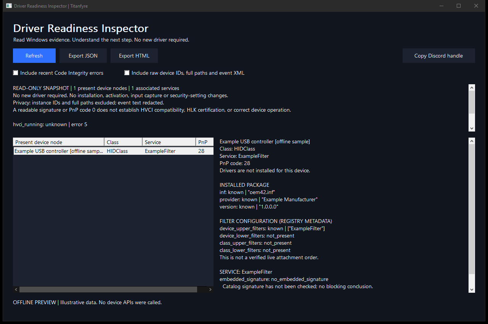

# Driver Readiness Inspector

**Read-only Windows driver diagnostics for OEM support, integrators and IT teams.**

Inspect the evidence behind a missing device, driver startup failure or signing question. Browse Windows device nodes, compare their associated driver services, and save a local HTML or JSON support report.

**No additional driver is required.** This application uses Windows APIs in user mode. It does not install drivers, capture keyboard/mouse input, activate a license, change security settings or upload reports.



[Download Windows x64](https://github.com/titanfyre/Driver-Readiness-Inspector/releases/latest) · [How results work](docs/RESULTS.md) · **OEM deployment/support: add `titancsa` on Discord**

## Start

1. Download and extract the Windows x64 release ZIP.
2. Open `DriverReadinessInspector.exe`. No installation or administrator prompt is required.
3. Select a device node to read its PnP problem code, package metadata, filter configuration and associated service/binary evidence.
4. Use **Export HTML** for a readable report or **Export JSON** for support tooling. Choose a new filename; existing files are preserved.

The inventory is collected in a background worker, on startup and when you press **Refresh**. There is no idle monitoring loop. The tool can run without elevation; some observations may be unavailable or access denied. An unknown field is retained as an unknown field.

Windows lists several PnP nodes for many physical devices. The row count is therefore **not a physical device count**. Associated user-mode services are listed, but only local kernel/filesystem-driver binaries are inspected.

## Evidence collected

| Evidence | What it tells you |
|---|---|
| Windows version/build | Version reported by Windows, with x64 process architecture |
| PnP state and problem code | Windows' current device-node status and an actionable explanation |
| Package metadata | Provider, version, date and installed INF filename |
| Device/class filters | Registry-configured filter service names; not verified live attachment order |
| Service state | SCM state, configured start type and reported service exit code |
| SHA-256 | Contents of a local on-disk binary, bounded to 128 MiB |
| Embedded Authenticode | Offline cached trust result and embedded signer name, where present |
| Secure Boot / HVCI | Read-only reported state, with HVCI configuration separated from runtime enforcement |
| Optional Code Integrity events | At most 64 recent warning/error/critical events from the previous seven days |

The application **does not** certify a package, run HLK/Driver Verifier, prove HVCI compatibility, scan memory or determine whether a driver is safe. A valid catalog signature can exist without an embedded signature. An embedded trust failure does **not** establish that Windows blocked the driver. See [result interpretation and limits](docs/RESULTS.md).

## Command line

```powershell
.\DriverReadinessInspector.exe --report .\support.json
.\DriverReadinessInspector.exe --report .\support.html --format=html --events
```

Reports never overwrite existing files. Exit codes: `0` report written / offline fixtures passed; `1` file, collection or fixture failure; `2` invalid arguments; `3` report written but initial device enumeration failed. Per-field errors and partial collection are recorded inside an otherwise successful report; automation should inspect the `collection` object and observation statuses.

Offline modes use demonstration data and never inventory devices:

```powershell
.\DriverReadinessInspector.exe --preview
.\DriverReadinessInspector.exe --preview --report .\sample.html --format=html
.\DriverReadinessInspector.exe --self-test
```

The self-test creates and removes its own temporary fixture file and local directory junction to check path rejection. It does not inspect installed drivers, access network shares or change security settings.

## Privacy

By default, exported reports omit PnP instance IDs, full driver binary paths and event payloads. Device/provider labels, Windows build, service names, package versions and binary hashes remain useful diagnostic information and may still identify your hardware or software. **Review a report before sharing it.**

Raw identifiers, full paths and event XML are included only after selecting **Include raw device IDs, full paths and event XML** and refreshing, or explicitly passing `--include-sensitive`. Raw event payloads can contain usernames, private filenames or other identifiers. There is no telemetry, network upload, account, key or automatic public sharing. Authenticode verification uses cached trust only; it does not request online revocation data.

Binary inspection accepts bounded paths on local fixed volumes. It rejects reparse points, including directory junctions and symbolic links, verifies each opened component, and passes the same opened file to hashing and signature verification. Ambiguous or inaccessible paths are skipped. This policy avoids following ordinary local junctions to network shares; it is not a security boundary against privileged filesystem changes. See [inspection boundaries](docs/RESULTS.md#boundaries).

## Build

Windows 10/11 x64, Visual Studio C++ tools, Windows SDK and CMake are required. No WDK or kernel signing certificate is needed.

```powershell
.\Build.ps1
.\Build.ps1 -AddressSanitizer
```

The executable is placed in `obj\Build\bin\Release`. The build selects installed Visual Studio C++ tools; the ASAN build requires a current matching AddressSanitizer component and uses it without permanently changing `PATH`. Offline tests cover malformed registry values, Unicode/string boundaries, schema round-trips, status interpretation, HTML injection escaping, local binary-path rejection and sample exports. See [validation](docs/VALIDATION.md) for the tested scope.

## Commercial integration

The application source is MIT licensed and can be used commercially. For an OEM-branded support collector, deployment integration, a tailored report or paid support, add **`titancsa`** on Discord and mention **Driver-Readiness-Inspector**. The utility itself has no demo timer or paid feature lock.

This project is independent of Microsoft. Using Windows APIs or displaying a signature result does not mean Microsoft certifies or endorses this application. Microsoft, Windows and third-party product names belong to their respective owners.

Use this tool only on systems you own or are authorized to inspect. It is intended for legitimate diagnostics and support. Users are responsible for their use and for protecting exported information. The software is provided without warranty under the [MIT license](LICENSE); this notice does not override applicable law.
